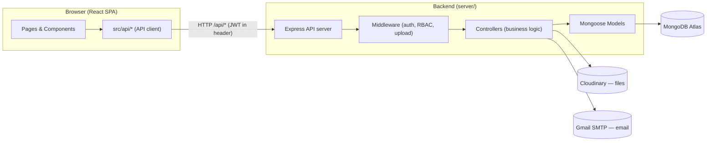
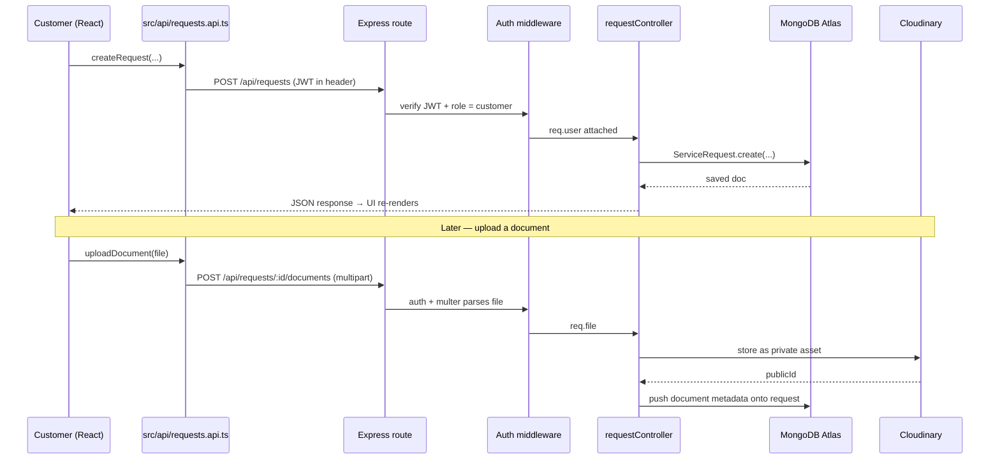

# Mahabharat Consultancy — One Stop Service Center

A full-stack **MERN** web application for an internet café / online-services center.
Customers request government & online services (Aadhaar, PAN, GST, exam/job forms,
printing, bill payments, etc.), upload documents, pay, and download completed
deliverables. Agents process the requests; admins manage everything.

> **Disclaimer shown in-app:** Mahabharat Consultancy is a private assistance / service
> center — *not* a government agency. It only helps users apply on official portals.

---

## Tech Stack

| Layer        | Technology                                                                 |
|--------------|----------------------------------------------------------------------------|
| Frontend     | React 19 + TypeScript + Vite, Tailwind CSS, shadcn/ui, GSAP (animations)   |
| Routing      | React Router (HashRouter)                                                  |
| Backend      | Node.js + Express                                                          |
| Database     | MongoDB (MongoDB Atlas in production) via Mongoose                         |
| Auth         | JWT (stateless), bcrypt password hashing, role-based access control        |
| File storage | Cloudinary (private/authenticated assets) with local-disk fallback        |
| Email        | Nodemailer over Gmail SMTP (welcome + password-reset emails)               |

---

## High-Level Architecture



The **golden rule**: the frontend never talks to the database directly. It only calls
`src/api/*`, which call the backend routes → middleware → controllers → models → database.
Each layer has exactly one job.

---

## Project Structure

```
Mahabharat-Consultancy/
├── index.html                  # SPA entry HTML
├── package.json                # Frontend deps & scripts
├── vite.config.ts              # Vite config (base path + /api dev proxy)
├── tailwind.config.js          # Theme (navy/gold), fonts
├── tsconfig*.json              # TypeScript configs
├── public/                     # Static assets served as-is
├── dist/                       # Production build output (generated)
│
├── src/                        # ─────────── FRONTEND ───────────
│   ├── main.tsx                # App entry: mounts React + router
│   ├── App.tsx                 # Routes + layout (Navbar/Footer/mobile menu)
│   ├── index.css               # Theme tokens (navy/gold) + fonts
│   │
│   ├── pages/                  # One file per screen
│   │   ├── Home, Services, ServiceDetail, GovtJobs, Login, Signup
│   │   ├── customer/           # Dashboard, NewRequest, RequestDetail
│   │   ├── agent/              # AgentDashboard, TaskDetail
│   │   └── admin/              # Dashboard, Requests, Customers, Agents,
│   │                           #   Payments, Audit, Reports, Services, …
│   │
│   ├── components/             # Reusable UI
│   │   ├── Navbar, Footer, StatusBadge, StatusTimeline, WhatsAppButton
│   │   ├── DeleteAccountCard, ForgotPasswordDialog
│   │   ├── AnimatedList, Masonry, StaggeredMenu, MagicBento  # visual effects
│   │   └── ui/                 # shadcn/ui primitives (Button, Dialog, Input, …)
│   │
│   ├── api/                    # THE ONLY place that calls the backend
│   │   ├── auth, services, requests, payments, users
│   │   └── calls, jobs, stats, notifications, audit
│   │
│   ├── context/AuthContext.tsx # Logged-in user state (login/register/logout/delete)
│   ├── lib/apiClient.ts        # Axios instance + JWT token storage
│   ├── config/site.ts          # Shop info (email, phone, address)
│   ├── data/                   # Static catalogs (service icons, govt jobs)
│   ├── hooks/                  # Reusable hooks
│   ├── types/index.ts          # Shared TypeScript types
│   └── assets/services/        # Service logo images
│
└── server/                     # ─────────── BACKEND ───────────
    ├── .env                    # Secrets (gitignored — never committed)
    ├── .env.example            # Template for the above
    ├── package.json            # Backend deps & scripts
    └── src/
        ├── index.js            # Entry: connect DB, start HTTP server
        ├── app.js              # Express app: middleware + mount routes
        ├── seed.js             # Populate DB with starter data
        │
        ├── config/
        │   ├── env.js          # Reads & validates environment variables
        │   ├── db.js           # MongoDB / Atlas connection
        │   └── cloudinary.js   # Cloudinary SDK client
        │
        ├── routes/index.js     # ALL API endpoints in one router
        │
        ├── controllers/        # Business logic behind each route
        │   ├── authController       # register, login, me, deleteMyAccount,
        │   │                         #   forgotPassword, resetPassword
        │   ├── requestController, serviceController, paymentController
        │   ├── userController, miscController
        │
        ├── models/             # Mongoose schemas (the database shape)
        │   ├── User, ServiceRequest, Payment, Service
        │   ├── Profiles (Customer/Agent), Activity (Audit/Notification/CallLog)
        │   └── index.js
        │
        ├── middleware/
        │   ├── auth.js         # JWT verification + role checks (RBAC)
        │   ├── upload.js       # Multer file-upload handling
        │   └── error.js        # Central error formatting
        │
        ├── utils/
        │   ├── mailer.js       # Nodemailer (welcome + reset emails)
        │   ├── storage.js      # Persist/stream/delete files (Cloudinary/local)
        │   ├── serializers.js  # Shape DB docs for API responses
        │   ├── apiError.js, helpers.js
        │
        └── data/               # Seed catalogs (services, jobs)
```

---

## Request Workflow (end to end)

Example: a customer submits a new service request and later downloads the result.



**Service lifecycle (status flow):**
`submitted → documents_required → in_review → in_progress → waiting_otp →
waiting_payment → completed → delivered` (or `rejected` / `cancelled`).

Agents move a request through these states; payment is required before the
customer can download final deliverables.

---

## How the pieces connect

### Frontend → Backend API calls
- The browser only talks to **one origin**. In dev, [vite.config.ts](vite.config.ts)
  proxies every `/api/*` request to the backend at `http://localhost:5000`.
- [src/lib/apiClient.ts](src/lib/apiClient.ts) is an Axios instance that automatically
  attaches the JWT (`Authorization: Bearer <token>`) from local storage to every request.
- Each `src/api/*.ts` file wraps a group of endpoints (auth, services, requests, …)
  so components call typed functions like `Req.createRequest(...)` instead of raw URLs.

### MongoDB Atlas (database)
- All persistent data lives in MongoDB. In production this is **MongoDB Atlas** (cloud).
- The connection string is read from `MONGODB_URI` in `server/.env`
  ([config/db.js](server/src/config/db.js)).
- Mongoose **models** (`server/src/models/`) define the schema for each collection:
  `users`, `servicerequests`, `payments`, `services`, profiles, and activity logs.
- For zero-config local dev you can leave `MONGODB_URI` blank — the server spins up an
  in-memory MongoDB automatically.
- **Atlas note (free M0 tier):** 512 MB storage (plenty, since files live in Cloudinary,
  not Mongo), no automated backups, may auto-pause after long inactivity. Enable backups
  and tighten network access before going live.

### Cloudinary (file storage)
- Uploaded documents and final deliverables are **not** stored in MongoDB. They go to
  **Cloudinary** as **private / authenticated** assets ([utils/storage.js](server/src/utils/storage.js)).
- Only the file **metadata** (Cloudinary `publicId`, type, name) is saved on the request
  document in Mongo.
- Downloads are served via short-lived **signed URLs**, gated behind auth + payment checks —
  files are never publicly accessible.
- If Cloudinary credentials are absent, storage falls back to the local `uploads/` disk folder.

### Email (Gmail SMTP)
- [utils/mailer.js](server/src/utils/mailer.js) sends a **welcome email** on signup and a
  **6-digit password-reset code** on "Forgot password" — via the shop's Gmail using an
  **App Password** (`EMAIL_USER` / `EMAIL_PASS`). No paid third-party service.

---

## User Roles (RBAC)

| Role     | Can do                                                                       |
|----------|------------------------------------------------------------------------------|
| Customer | Sign up, create requests, upload documents, pay, download deliverables, self-delete account |
| Agent    | View assigned tasks, process them, upload deliverables, request masked calls, self-delete (if no active tasks) |
| Admin    | Manage services, assign agents, approve payments, manage users, view stats & audit logs |

Enforced by [middleware/auth.js](server/src/middleware/auth.js) (`requireAuth`, `requireRole`).

**Separate login doors:**
- **Customers** sign in at `/login` (linked from the public site).
- **Agents & admins** sign in at `/staff` — a private page not linked anywhere public; share the URL with staff directly. Each page only accepts its allowed roles.

---

## Environment Variables (`server/.env`)

> Copy `server/.env.example` → `server/.env` and fill in. **Never commit `.env`.**

| Variable | Purpose |
|----------|---------|
| `PORT` | Backend port (default 5000) |
| `NODE_ENV` | `development` / `production`. **Must be `production` on the live deployment** — the fail-closed `JWT_SECRET` / `CLIENT_URL` checks only run then. |
| `MONGODB_URI` | MongoDB Atlas connection string (blank = in-memory dev DB) |
| `JWT_SECRET` | **Required in production** (≥32 random chars). Server fails closed if missing/weak. Use a different value per environment. |
| `JWT_SECRET_ROTATED` | Set `true` after rotating JWT_SECRET away from any previously exposed value |
| `JWT_EXPIRES_IN` | Token lifetime (default `8h` in production) |
| `CLIENT_URL` | **Required in production** — trusted frontend origin(s), comma-separated |
| `VERCEL_PREVIEW_ORIGINS` | Optional exact preview origins (no `*.vercel.app` wildcard) |
| `MAX_UPLOAD_MB` | Max upload size |
| `UPLOAD_DIR` | Local fallback folder for uploads |
| `CLOUDINARY_CLOUD_NAME` / `CLOUDINARY_API_KEY` / `CLOUDINARY_API_SECRET` | Cloudinary credentials (file storage) |
| `EMAIL_USER` / `EMAIL_PASS` / `EMAIL_FROM_NAME` | Gmail SMTP (App Password) for emails |
| `CALL_PROVIDER` | Masked-calling provider (`stub` by default) |

---

## Getting Started (local development)

**Prerequisites:** Node.js 18+, and either a MongoDB Atlas URI or nothing (in-memory DB).

```bash
# 1) Backend
cd server
cp .env.example .env        # then fill in values (or leave MONGODB_URI blank)
npm install
# Destructive seed is DEV ONLY and requires confirmation:
#   PowerShell: $env:CONFIRM_SEED="YES"; npm run seed
#   bash:       CONFIRM_SEED=YES npm run seed
# Prefer create-admin for real privileged accounts (never seed production).
npm run dev                 # starts API on http://localhost:5000

# 2) Frontend (in a second terminal, from the project root)
npm install                 # or: pnpm install
npm run dev                 # starts Vite on http://localhost:5173
```

Open **http://localhost:5173/Mahabharat-Consultancy/**

| Script (frontend) | Does |
|---|---|
| `npm run dev` | Start Vite dev server |
| `npm run build` | Production build → `dist/` |
| `npm run preview` | Preview the production build |
| `npm run lint` | Run ESLint |

| Script (server) | Does |
|---|---|
| `npm run dev` | Start API with auto-reload (nodemon) |
| `npm start` | Start API (plain node) |
| `npm run seed` | Destructive demo seed — **dev only**, requires `CONFIRM_SEED=YES` |
| `npm run create-admin` | Create/update a real admin (safe for production) |
| `npm run test:security` | Security regression suite |

---

## API Endpoints (reference)

Base path: `/api`. 🔒 = requires JWT; roles noted where restricted.

**Auth & account**
```
POST   /auth/register            Register a customer
POST   /auth/login               Login (email or phone + password)
POST   /auth/forgot-password     Email a 6-digit reset code
POST   /auth/reset-password      Verify code + set new password
GET    /auth/me              🔒  Current user
DELETE /account              🔒  Delete own account (customer/agent)
```

**Services & jobs**
```
GET    /services/categories      List categories
GET    /services                 List services
GET    /services/:id             One service
POST   /services             🔒 admin   Create
PATCH  /services/:id         🔒 admin   Update
PATCH  /services/:id/toggle  🔒 admin   Enable/disable
GET    /jobs                     Govt job listings
```

**Requests** (all 🔒)
```
GET    /requests                         List (scoped by role)
POST   /requests             customer    Create
GET    /requests/:id                     One request
PATCH  /requests/:id                     Update
PATCH  /requests/:id/status              Change status
PATCH  /requests/:id/assign  admin       Assign agent
PATCH  /requests/:id/ready   agent/admin Mark ready for payment
POST   /requests/:id/comments            Add comment
POST   /requests/:id/documents           Upload document (multipart)
DELETE /requests/:id/documents/:docId    Remove document
GET    /requests/:id/documents/:docId/download
POST   /requests/:id/deliverables  agent/admin   Upload deliverable
GET    /requests/:id/deliverables/:delId/download
POST   /requests/:id/pay     customer    Record a payment
PATCH  /requests/:id/payment/received  admin  Confirm payment
POST   /requests/:id/call-requests agent/admin  Request masked call
GET    /requests/:id/calls               List calls
PATCH  /requests/:id/calls/:callId/complete  agent/admin
```

**Admin / misc** (🔒 admin unless noted)
```
GET    /payments                 List payments
GET    /users/customers          List customers
GET    /users/agents             List agents
POST   /users/agents             Create agent
PATCH  /users/:id/active         Activate/deactivate
PATCH  /users/:id                Update user
DELETE /users/:id                Delete user
GET    /stats/admin              Dashboard stats
GET    /stats/agents             Agent performance
GET    /audit                    Audit log
GET    /call-requests            Pending masked-call requests
PATCH  /call-requests/:callId    Approve/deny call
GET    /notifications        🔒  Current user's notifications
PATCH  /notifications/read-all 🔒
PATCH  /notifications/:id/read 🔒
GET    /health                   Health check
```

---

## Deployment notes

- **Backend** → host on Render / Railway / Fly.io with environment variables set there
  (do not commit `.env`). Point `MONGODB_URI` at MongoDB Atlas.
- **Frontend** → `npm run build` then deploy `dist/`. If using **GitHub Pages**, the
  `base` path in [vite.config.ts](vite.config.ts) must match the repo name
  (currently `/Mahabharat-Consultancy/`). Set `VITE_PROXY_TARGET` / the API base to the
  deployed backend URL.
- Rotate any credentials that were ever shared in plain text before going to production.

---

## Browser extension — technical readiness report (29 October 2026)

**Summary.** The form-automation foundation is complete and tested locally in Chrome and Edge.
**No government portal can be filled by the extension today.** GST and PMEGP have adapters,
but normal filling is off for both. Each needs captures the applicant takes after their own
verification step, and then a supervised trial the applicant runs. Army, Navy, Air Force and
Postal GDS have no adapter, because their application forms have never been captured.

The client-facing explanation of the workflow, installation, status and testing checklist is in
[`Mahabharat_Consultancy_Automation_Workflow_Report.pdf`](Mahabharat_Consultancy_Automation_Workflow_Report.pdf).

### Components

| Part | Location | Role |
|---|---|---|
| Assistant extension (Manifest V3) | `extension/manifest.json`, `extension/src/` | Toolbar popup, website connection, portal content script |
| Form engine | `extension/src/engine/` | Registry, adapter rules, classification, values, preview, protocol, DOM fill |
| Portal registry | `extension/src/engine/registry.js` | One entry per portal: status, exact origins, readiness flags, supervised-trial declaration |
| Adapters | `extension/adapters/*.js` | GST and PMEGP field mappings (not loaded by any manifest) |
| Adapter scaffolds | `extension/adapters/scaffolds/` | Evidence, blockers, capture and trial procedures per portal (never loaded) |
| Structure inspector | `extension/inspect/` | Separate, local-only extension: the applicant saves a sanitised form-structure capture |
| Evidence tools | `extension/tests/adapter-fixture-template.mjs`, `extension/tools/adapter-check.mjs` | Capture, gate, trial-eligibility, trial-record and production-readiness checks |
| Backend endpoint | `GET /api/requests/:id/autofill` | Read-only applicant values for one open request; only its customer, its assigned agent or an admin |

### Security and permission boundaries

- **Permissions:** `permissions: []`. `host_permissions` are exactly `https://www.mahabharat.net.in/*` and `http://localhost:5173/*`. There are no government host permissions.
- **Content scripts:** they run only on `https://pmegp.msme.gov.in/Home/HomePage*` and `https://reg.gst.gov.in/registration*`, in the top frame only. They answer detection with the registry status and fill nothing, because no adapter file is loaded.
- **Inspector:** it is limited to the exact origins in `extension/inspect/origins.js`. Shared vendor hosts such as `cdn.digialm.com` and `navydmpr.in` are excluded.
- **Website connection:** the browser's own session cookie is used for GET requests only. No password, token or cookie is read, stored or forwarded, and CSRF protection on non-GET routes is untouched. Another customer's request and a request that doesn't exist both get the same 404.
- **Messages:** only this extension's popup is answered. Each message has a strict shape, is checked against a page nonce, and is version-tagged; web pages cannot reach the engine.
- **Applicant values:** they are held in memory only and never written to storage, cookies, logs or downloads. A preview that is cancelled, replaced or expired is dropped from the page.
- **Normal filling:** it requires an adapter whose registry entry is `verified_supported`. Each fill needs a fresh preview (5 minutes, single use), per-field ticks and an explicit confirmation.
- **Revalidation:** every field is checked again just before it is filled (label, type, length and pattern limits, visibility, lock, protection).
- **Never automated:** CAPTCHA, OTP, passwords, Aadhaar and PAN numbers, declarations, uploads, payment, submission, and Proceed or Validate buttons.
- **Supervised trial** (`supervised_verification_only`): it never enables normal filling and covers only the fields declared in the registry. It requires matching capture facts, a fresh 2-minute single-use preview and the applicant's confirmation, and it can be cancelled at once. The download-only record holds metadata, never values.

### Readiness by level

| Level | Status |
|---|---|
| A. Automation foundation complete | **Yes.** Engine, popup, protocol, registry, inspector, evidence checks, supervised mode and production-readiness check are implemented. |
| B. Locally tested functionality | **Yes, with local fixtures and synthetic data only.** The mock portal end-to-end flow, the GST and PMEGP stand-ins rendered from their public captures, and the supervised trials all pass in Chrome and Edge. This does not prove a live government integration. |
| C. Real portal structure verified | **Partly.** The public, pre-verification pages of PMEGP (98 fields) and GST part A (8 fields) are captured. The pages after Aadhaar validation (PMEGP) and after Proceed (GST) are **not** captured. Army, Navy, Air Force and Postal GDS: no application form captured. |
| D. Real-page filling verified | **No.** No supervised trial has been run and no trial record exists. |
| E. Production-enabled adapters | **None.** No registry entry is `verified_supported`. |
| F. Awaiting applicant participation | GST and PMEGP: post-gate captures, then supervised trials. Army, Navy, Air Force, Postal GDS: application-form captures (and, where the form is on another host, an explicit host decision first). |

### Adapter readiness flags and blockers

| Readiness flag | GST part A | PMEGP new unit |
|---|---|---|
| Registry status | `adapter_pending_verification` | `adapter_pending_verification` |
| `publicFormInspected` | true | true |
| `adapterImplemented` | true (version 1.0.0) | true (version 1.0.0) |
| `localFixtureTestsPassed` | true | true |
| `postValidationVerified` | **false**: no capture after Proceed | **false**: no capture after Aadhaar validation |
| `realPageFillVerified` | **false**: no supervised trial record | **false**: no supervised trial record |
| Trial eligibility (`npm run adapter:check`) | `awaiting_capture` | `awaiting_capture` |
| Production readiness | not ready | not ready |

| Portal | Captured fields | Mapped | Protected | Ambiguous | Unsupported | Remaining dependency |
|---|---|---|---|---|---|---|
| GST part A (`reg.gst.gov.in`) | 8 | 2: `#email`, `#mobile` | 2 (PAN, legal name) | 0 | 4 | Applicant-run capture after Proceed; supervised trial |
| PMEGP (`pmegp.msme.gov.in`) | 98 | 4: communication taluka, PIN, mobile, email | 51 (Aadhaar, PAN, OTP, CAPTCHA, logins, Aadhaar-derived) | 6 | 37 | Applicant-run captures after Aadhaar validation; supervised trial |
| Army Agniveer | none | 0 | — | — | — | Form behind CAPTCHA gate and sign-in; linked login on `cdn.digialm.com` (not authorised) |
| Navy Agniveer | none | 0 | — | — | — | No application window open; signups on `navydmpr.in` (not authorised) |
| Air Force Agniveervayu | none | 0 | — | — | — | Behind applicant login, most likely on `cdn.digialm.com` (not authorised) |
| Postal GDS | none | 0 | — | — | — | Registration closed for the current schedule |

The per-field decisions are in `extension/tests/gst-coverage.mjs` and `extension/tests/pmegp-coverage.mjs`, and the tests require them to cover each capture exactly.

**GST and PMEGP need applicant-run captures and supervised trials before production enablement.** The steps for each:

1. The applicant uses the inspector to capture the page after their own verification step.
2. `npm run adapter:check -- <id>` reports the trial as eligible.
3. A developer makes one explicit change: registry status `supervised_verification_only`, `adapterId`, `postValidationVerified: true`, and the adapter file added to the content script.
4. The applicant runs the supervised trial and saves the downloaded record in `extension/tests/fixtures/adapters/<id>/trials/`.
5. `realPageFillVerified` is set only when the latest valid record passed.
6. The production-readiness check and every regression test pass.
7. Normal filling is enabled by a separate, explicit decision.

The tests refuse any step taken without the evidence behind it.

Army, Navy, Air Force and Postal GDS stay pending until their application forms are captured by an applicant who signs in themselves. Where a form lives on a host that is not authorised today (`cdn.digialm.com`, `navydmpr.in`), someone must explicitly decide to add that host first. Each then needs an adapter written from the captures and the same evidence steps.

### Running the extension tests

```bash
npm run test:extension                       # extension + engine (Node)
npm run test:extension:inspect               # inspector unit tests
npm run test:extension:adapters              # capture, gate, trial and readiness evidence
npm run adapter:check -- gst-registration    # or pmegp-application
node extension/tests/<suite>.mjs --browser chrome|edge
#   suites: inspect-smoke, browser-smoke, portal-smoke, adapter-fixture-smoke,
#           gst-adapter-smoke, gst-page-smoke, pmegp-adapter-smoke, pmegp-page-smoke, supervised-smoke
```

`browser-smoke`, `portal-smoke` and `supervised-smoke` all use ports 5000 and 5173, so run them one at a time.
```
